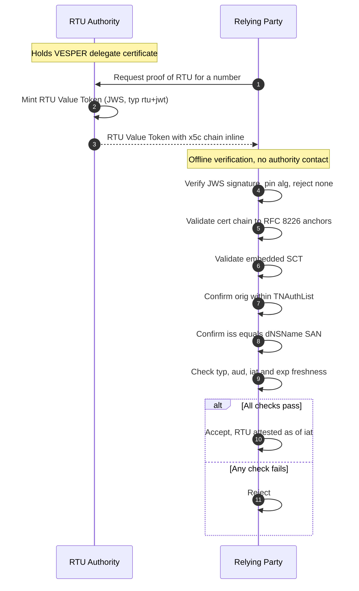
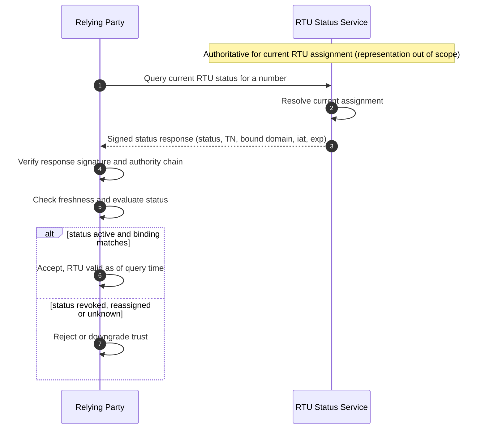
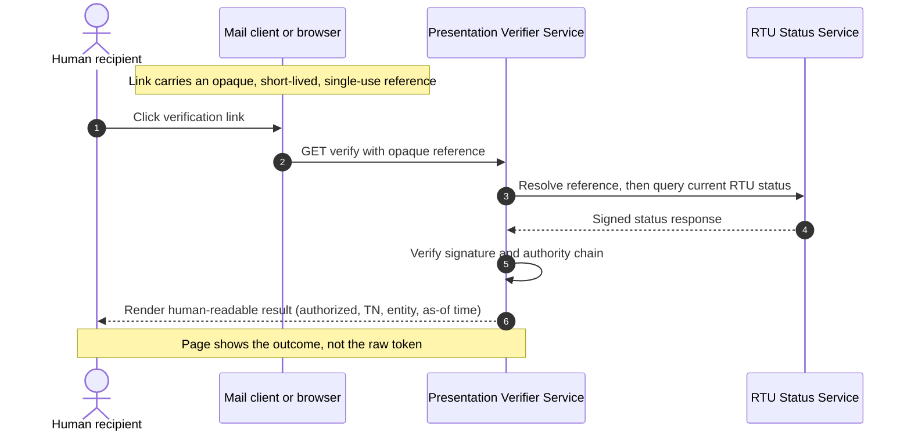

# Proposal: Splitting RTU Evidence into Two Artifacts

## 1. Motivation

The current Section 5 defines a single "RTU Token" - a JWT signed by the
delegate certificate private key - and asks it to serve two purposes that
have fundamentally different trust and freshness properties:

1. **Portable, offline evidence** of right-to-use ("letter-of-authorization
   replacement"), verifiable without contacting any authority.
2. **A live answer** to "does this entity hold RTU for this number *right
   now*," suitable for machine-to-machine checks and human-facing
   verification pages.

A self-signed JWT cannot do both. A signed token attests to RTU *as of its
`iat`, valid through its `exp`*. It cannot reflect a reassignment or
revocation that occurs after signing but before expiry. The authoritative
answer to "right now" is held by the **RTU Authority**, not
by the Domain Operator self-signing a token.

This proposal is to resolve this by defining **two distinct artifacts** with
clear, non-overlapping responsibilities.

## 2. The Two Artifacts

| Property | Artifact A: RTU Value Token | Artifact B: RTU Status |
|---|---|---|
| Form | Signed JWT (JWS) | Online query + signed response |
| Trust source | Domain Operator's delegate cert | RTU Authority |
| Freshness | Point-in-time (`iat`..`exp`) | Real-time (as of query) |
| Network needed to verify | No (offline) | Yes (live) |
| Answers | "Entity asserted RTU at `iat`" | "Entity holds RTU now" |
| Primary use | M2M proof, portable evidence | M2M live check, human pages |

### 2.1 Artifact A - RTU Value Token (offline, point-in-time)

A self-contained JWS signed by the delegate certificate private key, carrying
its chain inline. It is the cryptographic restatement of the certificate's
binding, scoped to a specific telephone number and a short validity window.

**JOSE header**

- `alg`: MUST match the delegate certificate key type (e.g. `ES256`).
  Verifiers MUST reject `none` and any `alg` inconsistent with the
  certificate key.
- `typ`: MUST be a distinct media type (e.g. `rtu+jwt`) so an RTU Value Token
  cannot be substituted for a PASSporT, or vice versa, even though both are
  signed by the same key.
- `x5c`: the certificate chain, conveyed inline.
- `x5u` (OPTIONAL): the domain-controlled repository URL, allowing a verifier
  to confirm the certificate is still published.

**Claims**

- `iss`: the entity's domain, matching the dNSName SubjectAltName.
- `iat`, `exp`: issuance and expiry. `exp` SHOULD be short to bound replay.
- `orig`: the telephone number being asserted, within the certificate's
  TNAuthList.
- `aud` (OPTIONAL): the intended relying party, to scope the token and limit
  relay.
- `jti` (OPTIONAL): a unique identifier, enabling correlation and revocation.
- Additional claims (e.g. Rich Call Data) only as authorized by the
  certificate's JWTClaimConstraints.

**Semantics.** The token attests that, at `iat`, the holder of the delegate
certificate asserted right-to-use for `orig`, valid through `exp`. It is a
signed *attestation by the issuer*, not proof that any later *presenter* holds
the key. It makes no claim about RTU status after `iat`.

**Verification procedure (new subsection, mirroring Section 4.4.2).** A
relying party MUST:

1. Verify the JWS signature; pin `alg`; reject `none`.
2. Validate the certificate chain to the trust anchors in [RFC8226].
3. Validate the embedded SCT.
4. Confirm `orig` is authorized by the certificate's TNAuthList.
5. Confirm `iss` equals the dNSName SubjectAltName (with defined
   normalization).
6. Confirm `typ`; if present, confirm `aud`; enforce `iat`/`exp` freshness.

The token MUST be rejected if any check fails.

### 2.2 Artifact B - RTU Status (authority-backed, real-time)

An online mechanism by which a relying party obtains the **current** RTU status
for a telephone number from the **RTU Authority**, which is authoritative for
the assignment. The query returns a signed status response that the relying
party verifies against the authority's chain.

**Deliberately out of scope.** The internal representation by which the RTU
Authority maintains and serves status, and the wire format of any status
distribution, are implementation details and are explicitly **not specified**
here. This keeps Artifact B free of normative dependencies on any particular
status-representation draft. This document defines only:

- the *query* (a telephone number, optionally an expected entity/domain
  binding to confirm),
- the *signed response* (current status, subject TN, optional bound domain,
  `iat`, `exp`), and
- the relying party's obligation to verify the response signature and
  authority chain and to enforce freshness.

**Semantics.** The response attests the RTU status as of the query time. A
positive result, bound to the expected domain, is the live confirmation that a
value token alone cannot provide.

## 3. Sequence Diagrams

### 3.1 Artifact A - Offline value token (M2M)

### 3.2 Artifact B - Authority-backed live status (M2M)

### 3.3 Artifact B applied - human-facing verification link

This reuses Artifact B behind a presentation layer. The email carries an
**opaque, short-lived, single-use reference**, never the value token itself, to
avoid token leakage through browser history, logs, `Referer`, and mail-gateway
link pre-fetching.

